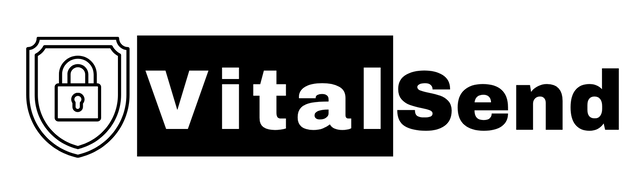

<picture>
  <source media="(prefers-color-scheme: dark)" srcset="logo-dark.png">
  
</picture>

# VitalSend

EU-based service for irreversible, one-time encrypted file handover.
A file is accessed exactly once, then destroyed.

[vitalsend.eu](https://vitalsend.eu)

## What's here

- **[mcp](https://github.com/vitalsend/mcp)**: send a file end-to-end encrypted from your AI
  agent. A plugin marketplace for Claude Code, Codex and Cursor, a Claude Desktop extension, and
  the npm package `@vitalsend/mcp`. Install steps per app: [vitalsend.eu/mcp](https://vitalsend.eu/mcp/).
- **[crypto](https://github.com/vitalsend/crypto)**: client-side encryption, KDF, share-link
  codec, and the chunked-AEAD worker. The reference implementation behind every VitalSend share
  link. Auditable; reproducible.

The service itself, its transport, and its orchestration remain closed.

## License

The published code is licensed under the **AGPL** (see each repo's `LICENSE` file).

A **commercial license is available** for use cases incompatible with
AGPL's copyleft. Contact `support@vitalsend.eu`.

## Security

To report a vulnerability:

- Email **`security@vitalsend.eu`**. Do not open a public GitHub issue.
- Full policy, scope, and safe harbour: [vitalsend.eu/security/disclosure/](https://vitalsend.eu/security/disclosure/)

## Who

Built by [Jörgen Karlsson](https://github.com/jorgen-k), founder of VitalSend.
